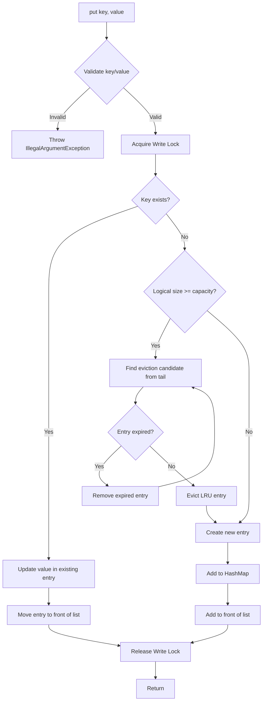
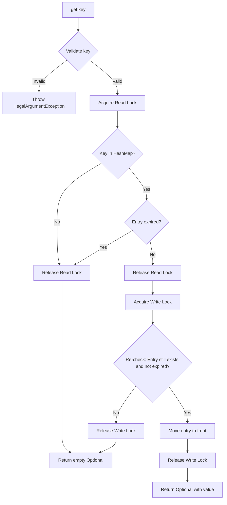
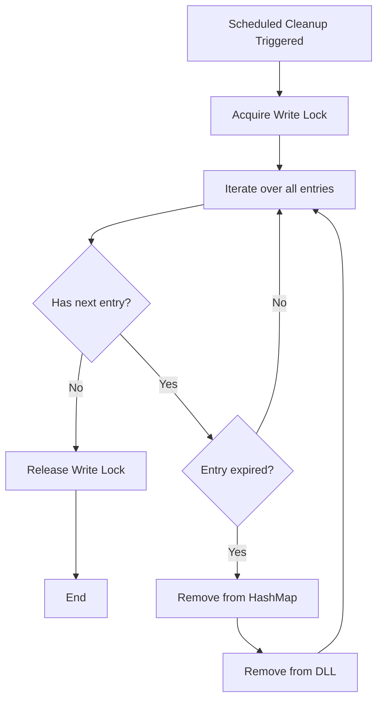
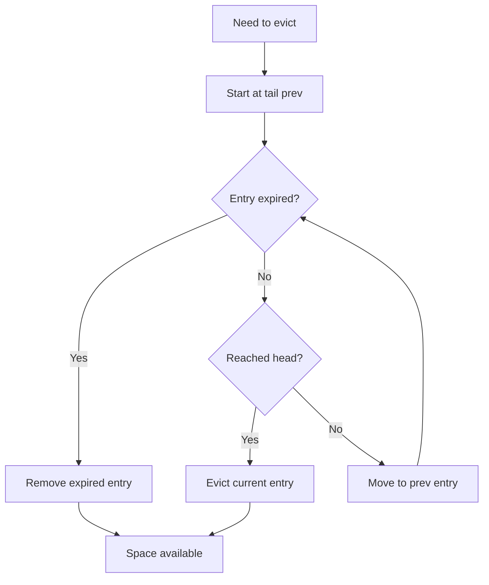

# Design Document: In-Memory Cache Phase 1

## Overview

This document describes the technical design for Phase 1 of an in-memory cache system in Java. The system implements a thread-safe, single-node key-value cache with LRU (Least Recently Used) eviction and TTL (Time To Live) expiry support.

### Core Capabilities

The cache provides:
- **Basic Operations**: Put, get, and remove operations with O(1) time complexity
- **LRU Eviction**: Automatic removal of least recently used entries when capacity is reached
- **TTL Expiry**: Time-based expiration of entries with both lazy and background cleanup
- **Thread Safety**: Safe concurrent access using Java concurrency primitives
- **Baseline Comparison**: A simple ConcurrentHashMap-based implementation for benchmarking

### Design Philosophy

This implementation prioritizes:
1. **Correctness**: Thread-safe operations with no data corruption under concurrent access
2. **Performance**: O(1) operations for put, get, and remove through careful data structure choice
3. **Educational Value**: Hand-rolled implementations (custom doubly-linked list, explicit locking) to demonstrate understanding of JVM concurrency
4. **Testability**: Comprehensive property-based and unit testing to verify correctness

## Architecture

### High-Level Structure

The cache system consists of three main components:

```
┌─────────────────────────────────────────────────┐
│              Cache Interface                     │
│  put(K, V), put(K, V, ttl), get(K), remove(K)   │
└─────────────────────────────────────────────────┘
                      ▲
                      │
          ┌───────────┴───────────┐
          │                       │
┌─────────┴──────────┐  ┌────────┴──────────┐
│   LRU Cache Impl   │  │  Baseline Cache   │
│  - HashMap + DLL   │  │ ConcurrentHashMap │
│  - Locking         │  │  (no eviction)    │
│  - TTL + Eviction  │  │                   │
└────────────────────┘  └───────────────────┘
          │
          │
┌─────────┴──────────┐
│ Background Cleanup │
│   (TTL Expiry)     │
└────────────────────┘
```

### Component Interaction

1. **Client Code** calls cache operations (put/get/remove)
2. **LRU Cache** manages storage using HashMap + doubly-linked list
3. **Locking Strategy** coordinates concurrent access
4. **Background Cleanup Thread** periodically removes expired entries
5. **Baseline Cache** provides comparison baseline for benchmarks


## Components and Interfaces

### 1. Cache Interface

The primary interface that defines cache operations:

```java
public interface Cache<K, V> {
    /**
     * Stores a key-value pair without expiration.
     * @throws IllegalArgumentException if key or value is null
     */
    void put(K key, V value);
    
    /**
     * Stores a key-value pair with TTL expiration.
     * @param ttlMillis time to live in milliseconds
     * @throws IllegalArgumentException if key or value is null
     */
    void put(K key, V value, long ttlMillis);
    
    /**
     * Retrieves a value by key.
     * @return Optional containing value if present and not expired, empty otherwise
     * @throws IllegalArgumentException if key is null
     */
    Optional<V> get(K key);
    
    /**
     * Removes an entry by key.
     * @throws IllegalArgumentException if key is null
     */
    void remove(K key);
    
    /**
     * Returns current number of entries (excluding logically expired entries).
     */
    int size();
    
    /**
     * Returns maximum capacity of the cache.
     */
    int capacity();
}
```

### 2. LRU Cache Implementation

The main implementation using HashMap and a custom doubly-linked list.

#### Internal Data Structures

**CacheEntry<K, V>**
```java
class CacheEntry<K, V> {
    K key;
    V value;
    long expiryTime;  // 0 or -1 for no expiration, else System.currentTimeMillis() + ttl
    CacheEntry<K, V> prev;
    CacheEntry<K, V> next;
}
```

**Core Fields**
```java
class LRUCache<K, V> implements Cache<K, V> {
    private final int capacity;
    private final Map<K, CacheEntry<K, V>> cache;  // HashMap for O(1) lookup
    private final CacheEntry<K, V> head;           // Dummy head (most recent)
    private final CacheEntry<K, V> tail;           // Dummy tail (least recent)
    private final ReadWriteLock lock;              // Synchronization primitive
    private final ScheduledExecutorService cleanupScheduler;  // Background cleanup
}
```

#### Doubly-Linked List Structure

The doubly-linked list maintains access order with dummy head and tail nodes. Most recently accessed entries are placed near the head, while least recently used entries drift toward the tail. When eviction is needed, the system removes entries from the tail end.

```
head <-> [Most Recent Entry] <-> [Entry 2] <-> ... <-> [Least Recent Entry] <-> tail
```

**Operations:**
- **Add to front** (after head): Mark entry as most recently used - O(1)
- **Remove node**: Detach node from list - O(1)
- **Move to front**: Remove then add to front - O(1)
- **Remove from back** (before tail): Evict least recently used - O(1)

### 3. Locking Strategy

The cache uses **ReentrantReadWriteLock** for thread safety with the following rationale:

**Why ReentrantReadWriteLock:**
- **Read-Heavy Workload**: Caches typically have more reads (get operations) than writes
- Multiple threads can read concurrently without blocking each other
- Write operations (put/remove) acquire exclusive locks
- Simpler than sharded locking for single-node Phase 1 implementation

**Locking Rules:**
- **Read Lock** (shared): Used for read-only access to HashMap and linked list - multiple concurrent readers allowed
- **Write Lock** (exclusive): Used for all modifications to HashMap or linked list - exclusive access
- **Lock Ordering**: Always acquire lock before accessing HashMap or linked list to prevent races
- **Critical**: ReentrantReadWriteLock does NOT support lock upgrade - attempting to acquire write lock while holding read lock will DEADLOCK

**Code Patterns:**

```java
// Read-only operation (no LRU update needed)
lock.readLock().lock();
try {
    // Access cache and linked list (read-only)
} finally {
    lock.readLock().unlock();
}

// Write operation
lock.writeLock().lock();
try {
    // Modify cache and linked list
} finally {
    lock.writeLock().unlock();
}

// Get operation with LRU update (double-checked locking)
lock.readLock().lock();
CacheEntry<K, V> entry;
try {
    entry = cache.get(key);
    if (entry == null || entry.isExpired()) {
        return Optional.empty();
    }
} finally {
    lock.readLock().unlock();
}

// Must release read lock before acquiring write lock to avoid deadlock
lock.writeLock().lock();
try {
    // Re-check entry still exists and isn't expired (state may have changed)
    entry = cache.get(key);
    if (entry != null && !entry.isExpired()) {
        moveToFront(entry);
        return Optional.of(entry.value);
    }
    return Optional.empty();
} finally {
    lock.writeLock().unlock();
}
```

**Alternative Considered: Sharded Locking**

Sharded locking (dividing cache into segments, each with its own lock) would allow operations on different key ranges to proceed concurrently. However, for Phase 1:
- Adds complexity without clear benefit at moderate scale
- LRU list updates still require coordination across shards
- Better suited for Phase 2 (distributed cache) where scalability is critical

### 4. TTL Expiry Mechanism

The cache implements a **dual-strategy expiry system**:

#### Lazy Expiry (On Access)

When `get(key)` is called:
1. Acquire read lock
2. Look up entry in HashMap
3. Check if `expiryTime > 0 && System.currentTimeMillis() > expiryTime`
4. If expired: return `Optional.empty()` (logically expired, not physically removed)
5. If not expired: update LRU position and return value

**Benefits:**
- Zero overhead when entries aren't accessed
- Expired entries don't consume capacity (treated as non-existent)

#### Background Cleanup (Physical Removal)

A scheduled background thread runs periodically:
1. Acquire write lock
2. Iterate through all entries (via HashMap or linked list)
3. Remove expired entries from both HashMap and linked list
4. Release write lock

```java
scheduledExecutor.scheduleAtFixedRate(() -> {
    lock.writeLock().lock();
    try {
        Iterator<Map.Entry<K, CacheEntry<K, V>>> iterator = cache.entrySet().iterator();
        while (iterator.hasNext()) {
            CacheEntry<K, V> entry = iterator.next().getValue();
            if (isExpired(entry)) {
                removeFromList(entry);
                iterator.remove();
            }
        }
    } finally {
        lock.writeLock().unlock();
    }
}, CLEANUP_INTERVAL, CLEANUP_INTERVAL, TimeUnit.MILLISECONDS);
```

**Configuration:**
- Cleanup interval: 1 second (configurable)
- Runs as daemon thread (doesn't prevent JVM shutdown)

### 5. Baseline Cache Implementation

A minimal cache implementation for performance comparison:

```java
class BaselineCache<K, V> implements Cache<K, V> {
    private final ConcurrentHashMap<K, V> cache = new ConcurrentHashMap<>();
    
    public void put(K key, V value) {
        cache.put(key, value);
    }
    
    public Optional<V> get(K key) {
        return Optional.ofNullable(cache.get(key));
    }
    
    public void remove(K key) {
        cache.remove(key);
    }
}
```

**Characteristics:**
- No capacity limits or eviction
- No TTL support
- Uses ConcurrentHashMap's internal striped locking
- Provides baseline for measuring LRU cache overhead


## Data Models

### CacheEntry<K, V>

Represents a single cache entry with LRU tracking and TTL support.

```java
class CacheEntry<K, V> {
    final K key;
    V value;
    long expiryTime;  // Expiration timestamp in milliseconds
    CacheEntry<K, V> prev;  // Previous node in doubly-linked list
    CacheEntry<K, V> next;  // Next node in doubly-linked list
    
    CacheEntry(K key, V value, long ttlMillis) {
        this.key = key;
        this.value = value;
        this.expiryTime = (ttlMillis > 0) 
            ? System.currentTimeMillis() + ttlMillis 
            : -1;  // -1 indicates no expiration
    }
    
    boolean isExpired() {
        return expiryTime > 0 && System.currentTimeMillis() > expiryTime;
    }
}
```

**Field Semantics:**
- `key`: Immutable cache key (final)
- `value`: Cached value (mutable to support updates)
- `expiryTime`: 
  - `-1` = no expiration
  - `> 0` = epoch milliseconds when entry expires
- `prev/next`: Pointers for doubly-linked list navigation

### LRU List Invariants

The doubly-linked list maintains these invariants under all operations:

1. **Dummy Nodes**: `head` and `tail` are always present and never removed
2. **Ordering**: Entries are ordered from most recent (after head) to least recent (before tail)
3. **Bidirectional Links**: For any node `n`: `n.next.prev == n` and `n.prev.next == n`
4. **Empty State**: When cache is empty, `head.next == tail` and `tail.prev == head`

### State Transitions

An entry can be in one of these logical states:

```
          put(key, value)
  [Non-existent] ──────────────> [Active]
                                    │
                                    │ TTL expires
                                    ▼
                     ┌──────> [Logically Expired] ──┐
                     │              │                │
                     │              │ background     │
       remove(key)   │              │ cleanup        │ get(key) returns empty
                     │              ▼                │
  [Active] ──────────┴────────> [Removed] <─────────┘
                                    │
                                    │
                                    ▼
                              [Non-existent]
```

**State Descriptions:**
- **Non-existent**: Key not in HashMap
- **Active**: Present in HashMap and linked list, not expired
- **Logically Expired**: Present in data structures but `isExpired() == true`; `get()` returns empty
- **Removed**: Physically removed from both HashMap and linked list

### Capacity Management

The cache maintains a **logical size** that excludes expired entries:

```java
int logicalSize() {
    int count = 0;
    for (CacheEntry<K, V> entry : cache.values()) {
        if (!entry.isExpired()) {
            count++;
        }
    }
    return count;
}
```

**Complexity**: O(n) - iterates through all entries to count non-expired ones.

**Alternative O(1) Implementation**: Maintain an incrementally-updated size counter that is decremented when expired entries are detected during lazy expiry checks or removed during background cleanup. This adds complexity but provides constant-time size queries.

**Eviction Decision:**
1. Check if `logicalSize() >= capacity` - **O(n)** due to iteration
2. If so, scan from tail (LRU end) to find eviction candidate - **O(k)** where k is number of expired entries at tail:
   - Skip expired entries (they don't count toward capacity)
   - Evict first non-expired entry
3. If all entries from tail are expired, remove expired entries until space is available


## Correctness Properties

*A property is a characteristic or behavior that should hold true across all valid executions of a system—essentially, a formal statement about what the system should do. Properties serve as the bridge between human-readable specifications and machine-verifiable correctness guarantees.*

**Property Reflection:**

After analyzing the acceptance criteria, I identified several areas of redundancy:

1. Properties 1.1 and 1.2 both verify the same put/get round-trip behavior - consolidated into Property 1
2. Property 3.3 (new entries are most recent) is implied by Property 3.1 (LRU eviction) - subsumed
3. Property 4.2 (preferential removal of expired entries) is identical to 3.6 - consolidated into Property 6
4. Property 4.4 (normal LRU when no expired entries) is already covered by Property 4 - redundant
5. Properties 8.1-8.4 all test null argument rejection - consolidated into Property 10

Each property below provides unique validation that cannot be inferred from other properties.

### Property 1: Put/Get Round-Trip

*For any* valid (non-null) key-value pair, storing it via `put(key, value)` and immediately retrieving it via `get(key)` SHALL return an `Optional` containing the same value.

**Validates: Requirements 1.1, 1.2**

### Property 2: Non-Existent Key Returns Empty

*For any* key that has never been added to the cache or has been removed, `get(key)` SHALL return an empty `Optional`.

**Validates: Requirements 1.3**

### Property 3: Remove Makes Entry Inaccessible

*For any* key-value pair, after storing it with `put(key, value)` and then calling `remove(key)`, subsequent `get(key)` calls SHALL return an empty `Optional`.

**Validates: Requirements 1.4**

### Property 4: Size Reflects Entry Count

*For any* sequence of put and remove operations on distinct keys (without TTL), `size()` SHALL equal the number of put operations minus the number of remove operations, capped at capacity.

**Validates: Requirements 1.5**

### Property 5: TTL Entry Initially Accessible

*For any* valid key-value pair with TTL > 0, immediately after `put(key, value, ttlMillis)`, `get(key)` SHALL return an `Optional` containing the value.

**Validates: Requirements 2.1**

### Property 6: Expired Entry Returns Empty

*For any* entry added with TTL, if sufficient time has passed such that `currentTime > insertionTime + ttlMillis`, then `get(key)` SHALL return an empty `Optional`.

**Validates: Requirements 2.2**

### Property 7: LRU Eviction at Capacity

*For any* cache at full capacity (containing N valid non-expired entries where N equals capacity), adding a new distinct key via `put()` SHALL result in the removal of the least recently accessed entry, and the new entry SHALL be accessible via `get()`.

**Validates: Requirements 3.1**

### Property 8: Get Updates LRU Recency

*For any* cache at capacity with entry E being the least recently used, if `get(E.key)` is called (updating E's recency) and then N-1 new distinct entries are added (where N is capacity), entry E SHALL still be accessible while entries that were more recent than E before the `get()` call have been evicted.

**Validates: Requirements 3.2**

### Property 9: Update Refreshes LRU Position

*For any* cache at capacity with existing entry E, calling `put(E.key, newValue)` (updating E) SHALL refresh E to the most-recently-used position such that E is not evicted before entries that were previously more recent than E.

**Validates: Requirements 3.4**

### Property 10: Expired Entries Preferentially Evicted

*For any* cache at capacity containing at least one expired entry and at least one valid entry, adding a new entry SHALL result in an expired entry being removed rather than a valid entry being evicted via LRU.

**Validates: Requirements 3.6, 4.2**

### Property 11: Expired Entries Don't Count Toward Capacity

*For any* cache containing N valid entries and M expired entries where N < capacity, `size()` SHALL return N (not N+M), and adding new entries SHALL not trigger eviction until N reaches capacity (regardless of M).

**Validates: Requirements 4.1, 4.3**

### Property 12: Thread Safety Under Concurrent Access

*For any* sequence of concurrent put, get, and remove operations executed by multiple threads on random keys, the cache SHALL not throw `ConcurrentModificationException` or exhibit data corruption, and all operations SHALL complete successfully with `size() <= capacity()` maintained.

**Validates: Requirements 5.1**

**Note**: This property verifies basic thread safety (no exceptions, no capacity violations) rather than full linearizability, as verifying linearizability requires more sophisticated testing infrastructure such as operation logs and reference model comparison.

### Property 13: Null Arguments Rejected

*For any* null key or null value, calling `put(null, value)`, `put(key, null)`, `get(null)`, or `remove(null)` SHALL throw `IllegalArgumentException`.

**Validates: Requirements 8.1, 8.2, 8.3, 8.4**

### Property 14: Zero Capacity Rejected

*For any* attempt to construct a cache with capacity ≤ 0, the constructor SHALL throw `IllegalArgumentException`.

**Validates: Requirements 9.1**

### Property 15: Capacity-One LRU Behavior

*For any* cache with capacity=1 containing one entry with key K1, calling `put(K2, value2)` where K2 ≠ K1 SHALL evict K1, and `get(K1)` SHALL return empty while `get(K2)` SHALL return the value.

**Validates: Requirements 9.3**

### Property 16: Capacity-One Update Behavior

*For any* cache with capacity=1 containing entry (K, V1), calling `put(K, V2)` SHALL update the value without eviction, and `get(K)` SHALL return V2.

**Validates: Requirements 9.4**


## Error Handling

### Null Argument Validation

All public methods validate arguments before processing:

```java
private void validateKey(K key) {
    if (key == null) {
        throw new IllegalArgumentException("Cache key cannot be null");
    }
}

private void validateValue(V value) {
    if (value == null) {
        throw new IllegalArgumentException("Cache value cannot be null");
    }
}
```

**Validation Points:**
- `put(K key, V value)`: Validates both key and value
- `put(K key, V value, long ttl)`: Validates both key and value
- `get(K key)`: Validates key
- `remove(K key)`: Validates key

### Capacity Validation

Constructor validates capacity on instantiation:

```java
public LRUCache(int capacity) {
    if (capacity <= 0) {
        throw new IllegalArgumentException(
            "Cache capacity must be positive, got: " + capacity);
    }
    this.capacity = capacity;
    // ... initialization
}
```

### Concurrency Exception Handling

The cache guarantees:
- **No ConcurrentModificationException**: All operations are protected by locks
- **No data corruption**: Write lock prevents concurrent modifications to shared state
- **No deadlocks**: Lock acquisition follows consistent ordering

### Background Cleanup Error Handling

The cleanup thread catches and logs exceptions to prevent thread termination:

```java
scheduledExecutor.scheduleAtFixedRate(() -> {
    try {
        cleanupExpiredEntries();
    } catch (Exception e) {
        logger.error("Error during background cleanup", e);
        // Continue running despite errors
    }
}, CLEANUP_INTERVAL, CLEANUP_INTERVAL, TimeUnit.MILLISECONDS);
```

### Shutdown Handling

The cache provides a `shutdown()` method to gracefully terminate the background cleanup:

```java
public void shutdown() {
    cleanupScheduler.shutdown();
    try {
        if (!cleanupScheduler.awaitTermination(5, TimeUnit.SECONDS)) {
            cleanupScheduler.shutdownNow();
        }
    } catch (InterruptedException e) {
        cleanupScheduler.shutdownNow();
        Thread.currentThread().interrupt();
    }
}
```

**Shutdown Sequence:**
1. Stop accepting new cleanup tasks
2. Wait up to 5 seconds for current cleanup to complete
3. Force shutdown if not completed
4. Restore interrupt status if interrupted during shutdown


## Testing Strategy

### Overview

The testing strategy employs a **dual approach** combining property-based testing for universal behaviors with example-based unit tests for specific scenarios and edge cases.

### Property-Based Testing

#### Library Selection

**JUnit-Quickcheck** ([repository](https://github.com/pholser/junit-quickcheck)) is selected for property-based testing in Java because:
- Integrates seamlessly with JUnit 5
- Provides generators for common Java types
- Supports custom generators for complex types
- Mature and actively maintained

**Configuration:**
- Minimum **100 iterations per property test** (due to randomization)
- Custom generators for keys, values, and operation sequences
- Deterministic seed option for reproducibility

#### Property Test Implementation

Each correctness property from the design SHALL be implemented as a property-based test with a comment tag referencing the design:

```java
@Property(trials = 100)
@Tag("Feature: in-memory-cache-phase1, Property 1: Put/Get Round-Trip")
public void putGetRoundTrip(@ForAll String key, @ForAll String value) {
    assumeThat(key, notNullValue());
    assumeThat(value, notNullValue());
    
    Cache<String, String> cache = new LRUCache<>(100);
    cache.put(key, value);
    
    Optional<String> result = cache.get(key);
    assertTrue(result.isPresent());
    assertEquals(value, result.get());
}
```

**Property Test Coverage:**
- **Property 1-6**: Basic operations and TTL behavior (Properties 1-6)
- **Property 7-11**: LRU eviction and TTL interaction (Properties 7-11)
- **Property 12**: Thread safety under concurrent load (Property 12)
- **Property 13-16**: Edge cases and error conditions (Properties 13-16)

#### Custom Generators

```java
// Generator for cache operation sequences
public class CacheOperationGenerator extends Generator<CacheOperation> {
    @Override
    public CacheOperation generate(SourceOfRandomness random, GenerationStatus status) {
        int opType = random.nextInt(0, 2);
        String key = random.nextString(10);
        String value = random.nextString(20);
        
        return switch (opType) {
            case 0 -> new PutOperation(key, value);
            case 1 -> new GetOperation(key);
            case 2 -> new RemoveOperation(key);
        };
    }
}
```

### Unit Testing

Unit tests complement property tests by covering:

#### Specific Examples
- **Baseline cache behavior**: Verify ConcurrentHashMap-based implementation
- **TTL edge cases**: Zero TTL, negative TTL handling
- **Capacity edge cases**: Capacity of 1, large capacities

#### Integration Tests
- **Background cleanup verification**: Put entries with TTL, wait for cleanup interval, verify physical removal
- **Cleanup and size consistency**: Verify `size()` updates after background cleanup runs
- **Sharded lock parallelism** (if implemented): Measure concurrent operation timing on different keys

#### Time-Based Tests

TTL tests use real time delays with safety margins:

```java
@Test
public void expiredEntryReturnsEmpty() throws InterruptedException {
    Cache<String, String> cache = new LRUCache<>(10);
    cache.put("key", "value", 100); // 100ms TTL
    
    // Verify accessible immediately
    assertTrue(cache.get("key").isPresent());
    
    // Wait for expiration with margin
    Thread.sleep(150);
    
    // Verify expired entry returns empty
    assertFalse(cache.get("key").isPresent());
}
```

### Concurrency Testing

#### Stress Tests

Multi-threaded stress tests verify thread safety:

```java
@Test
public void concurrentAccessStressTest() throws InterruptedException {
    Cache<String, String> cache = new LRUCache<>(100);
    int numThreads = 10;
    int operationsPerThread = 1000;
    ExecutorService executor = Executors.newFixedThreadPool(numThreads);
    CountDownLatch latch = new CountDownLatch(numThreads);
    
    for (int i = 0; i < numThreads; i++) {
        final int threadId = i;
        executor.submit(() -> {
            try {
                Random rand = new Random(threadId);
                for (int j = 0; j < operationsPerThread; j++) {
                    String key = "key-" + rand.nextInt(200);
                    switch (rand.nextInt(3)) {
                        case 0 -> cache.put(key, "value-" + j);
                        case 1 -> cache.get(key);
                        case 2 -> cache.remove(key);
                    }
                }
            } finally {
                latch.countDown();
            }
        });
    }
    
    latch.await(30, TimeUnit.SECONDS);
    executor.shutdown();
    
    // Verify cache is in consistent state (no exceptions thrown)
    assertTrue(cache.size() <= cache.capacity());
}
```

#### Concurrent Invariant Checks

Tests verify invariants under concurrent load:
- No `ConcurrentModificationException` thrown
- `size() <= capacity()` always holds
- Final state is consistent (sum of operations matches state)

### Test Organization

```
src/test/java/
├── cache/
│   ├── properties/          # Property-based tests
│   │   ├── BasicOperationProperties.java
│   │   ├── TTLExpiryProperties.java
│   │   ├── LRUEvictionProperties.java
│   │   └── ConcurrencyProperties.java
│   ├── unit/                # Example-based unit tests
│   │   ├── BasicOperationsTest.java
│   │   ├── TTLExpiryTest.java
│   │   ├── LRUEvictionTest.java
│   │   ├── EdgeCasesTest.java
│   │   └── BaselineCacheTest.java
│   ├── integration/         # Integration tests
│   │   ├── BackgroundCleanupTest.java
│   │   └── ConcurrencyStressTest.java
│   └── generators/          # Custom generators for PBT
│       └── CacheOperationGenerator.java
```

### Coverage Targets

- **Line Coverage**: > 90% for cache implementation
- **Branch Coverage**: > 85% for conditional logic
- **Property Coverage**: 100% of design properties have corresponding tests
- **Concurrency Coverage**: All public methods tested under concurrent access

### Benchmarking

Performance comparison between LRU cache and baseline:

```java
@State(Scope.Benchmark)
public class CacheBenchmark {
    private Cache<String, String> lruCache;
    private Cache<String, String> baselineCache;
    
    @Benchmark
    public void lruCacheGet(Blackhole blackhole) {
        blackhole.consume(lruCache.get("key-" + ThreadLocalRandom.current().nextInt(1000)));
    }
    
    @Benchmark
    public void baselineCacheGet(Blackhole blackhole) {
        blackhole.consume(baselineCache.get("key-" + ThreadLocalRandom.current().nextInt(1000)));
    }
}
```

**Metrics to Compare:**
- Throughput (operations/second) for get, put, remove
- Latency (p50, p95, p99) under various load levels
- Memory overhead (LRU structures vs ConcurrentHashMap only)
- Scalability (performance vs number of threads)


## Implementation Sequence

### Phase 1: Core Infrastructure (Week 1)

1. **Define interfaces and basic structure**
   - Create `Cache<K, V>` interface
   - Create `CacheEntry<K, V>` class
   - Implement doubly-linked list node structure

2. **Implement basic HashMap + DLL integration**
   - HashMap for O(1) key lookup
   - Doubly-linked list for LRU ordering
   - Basic put/get/remove without locking

3. **Add validation and error handling**
   - Null argument checks
   - Capacity validation
   - Exception types and messages

### Phase 2: LRU Eviction (Week 1-2)

1. **Implement LRU tracking**
   - Move-to-front operation
   - Remove-from-tail operation
   - Update recency on access

2. **Implement eviction logic**
   - Check capacity before put
   - Evict LRU entry when at capacity
   - Maintain list invariants

3. **Test LRU behavior**
   - Unit tests for eviction scenarios
   - Property tests for LRU ordering

### Phase 3: TTL Support (Week 2)

1. **Add TTL fields and expiry logic**
   - `expiryTime` field in `CacheEntry`
   - `isExpired()` method
   - Lazy expiry in `get()`

2. **Implement background cleanup**
   - `ScheduledExecutorService` setup
   - Periodic scan and removal
   - Shutdown handling

3. **Test TTL behavior**
   - Time-based tests with delays
   - Integration tests for background cleanup

### Phase 4: Thread Safety (Week 2-3)

1. **Add ReentrantReadWriteLock**
   - Protect all HashMap and DLL access
   - Read locks for `get()`
   - Write locks for `put()` and `remove()`

2. **Test concurrent access**
   - Stress tests with multiple threads
   - Property tests for concurrent operations
   - Verify no `ConcurrentModificationException`

### Phase 5: TTL + Eviction Interaction (Week 3)

1. **Implement logical size calculation**
   - Exclude expired entries from count
   - Preferential removal of expired entries

2. **Test interaction scenarios**
   - Property tests for mixed expired/valid entries
   - Verify capacity semantics

### Phase 6: Baseline and Benchmarking (Week 3-4)

1. **Implement baseline cache**
   - Simple ConcurrentHashMap wrapper
   - Same interface as LRU cache

2. **Set up benchmarks**
   - JMH benchmark suite
   - Compare throughput and latency
   - Document performance characteristics

### Phase 7: Comprehensive Testing (Week 4)

1. **Complete property test suite**
   - All 16 design properties implemented
   - Custom generators for complex scenarios

2. **Complete unit test suite**
   - Edge cases and error conditions
   - Integration tests

3. **Code review and documentation**
   - Inline comments explaining locking
   - README with usage examples
   - Performance analysis report

## Detailed Operation Flows

### Put Operation Flow



### Get Operation Flow



**Critical Deadlock Prevention**: ReentrantReadWriteLock does NOT support upgrading from read lock to write lock. The read lock MUST be released before acquiring the write lock. After acquiring the write lock, the entry must be re-checked since state may have changed between lock release and re-acquisition (double-checked locking pattern).

### Background Cleanup Flow



### Eviction Selection Flow



## Key Design Decisions and Rationale

### 1. HashMap + Doubly-Linked List vs LinkedHashMap

**Decision**: Use HashMap + custom doubly-linked list

**Rationale**:
- **Educational value**: Demonstrates understanding of data structure implementation
- **Flexibility**: Full control over list operations for TTL integration
- **Performance**: Direct node manipulation without LinkedHashMap overhead
- **Requirement compliance**: Explicit requirement to not use LinkedHashMap's LRU mode

**Trade-offs**:
- More code to maintain vs using built-in LinkedHashMap
- More potential for bugs in list manipulation
- Offset by comprehensive property-based testing

### 2. ReentrantReadWriteLock vs Sharded Locks

**Decision**: Use ReentrantReadWriteLock for Phase 1

**Rationale**:
- **Read-heavy workload**: Caches typically have more reads than writes ([research](https://www.javacodegeeks.com/2024/07/a-comprehensive-guide-to-optimistic-locking-with-javas-stampedlock.html) shows read-write locks excel in such scenarios)
- **Simplicity**: Single lock is easier to reason about and test
- **Correctness first**: Avoid premature optimization; sharded locks add complexity
- **Phase 1 scope**: Single-node implementation doesn't require extreme parallelism

**Alternative Considered**: StampedLock with optimistic reads
- Higher performance under contention ([benchmarks](https://stackoverflow.com/questions/43723900/why-java-stampedlock-faster-than-reentrantreadwritelock))
- More complex to use correctly (optimistic read validation)
- Deferred to future optimization after correctness is proven

### 3. Lazy + Background Cleanup vs Eager Expiry

**Decision**: Combine lazy expiry on access with periodic background cleanup

**Rationale**:
- **Lazy expiry**: Zero overhead for unaccessed expired entries
- **Background cleanup**: Prevents memory accumulation from never-accessed entries
- **Best of both**: Balances performance (lazy) with resource management (background)

**Configuration**:
- Cleanup interval: 1 second (configurable based on workload)
- Daemon thread: Doesn't prevent JVM shutdown

### 4. Logical vs Physical Size

**Decision**: Maintain logical size that excludes expired entries

**Rationale**:
- **Capacity semantics**: Expired entries shouldn't prevent new entries
- **User expectation**: `size()` should reflect accessible entries
- **Eviction optimization**: Prefer removing expired entries over valid LRU entries

**Implementation**:
- `size()` iterates and counts non-expired entries
- Eviction scans from tail, skipping expired entries
- Background cleanup physically removes expired entries

### 5. Double-Checked Locking for Get Operation

**Decision**: Release read lock, acquire write lock, then re-check entry state before updating LRU position

**Rationale**:
- **Deadlock prevention**: ReentrantReadWriteLock does NOT support lock upgrade - attempting to acquire write lock while holding read lock causes DEADLOCK
- **Correctness**: State may change between releasing read lock and acquiring write lock (entry could be removed or expire)
- **Pattern**: Double-checked locking ensures entry is still valid before modifying LRU position
- **Trade-off**: Slight performance cost from re-checking, but necessary for correctness

**Implementation**:
```java
// Phase 1: Check with read lock
lock.readLock().lock();
CacheEntry<K, V> entry;
try {
    entry = cache.get(key);
    if (entry == null || entry.isExpired()) {
        return Optional.empty();
    }
} finally {
    lock.readLock().unlock();  // MUST release before acquiring write lock
}

// Phase 2: Update LRU with write lock after re-checking
lock.writeLock().lock();
try {
    entry = cache.get(key);  // Re-check: state may have changed
    if (entry != null && !entry.isExpired()) {
        moveToFront(entry);
        return Optional.of(entry.value);
    }
    return Optional.empty();
} finally {
    lock.writeLock().unlock();
}
```

**Alternative Considered**: Always use write lock for `get()`
- Simpler (no double-checked locking complexity)
- Worse read concurrency (readers block each other)
- Rejected in favor of better read scalability

