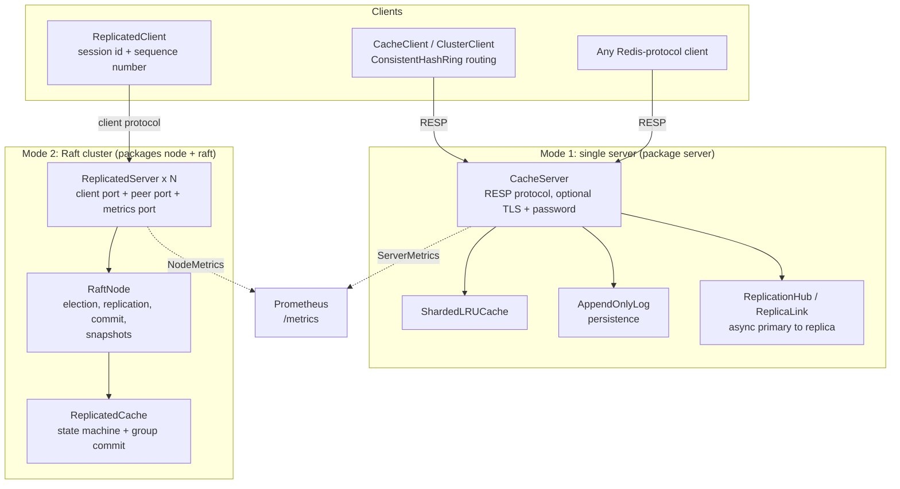
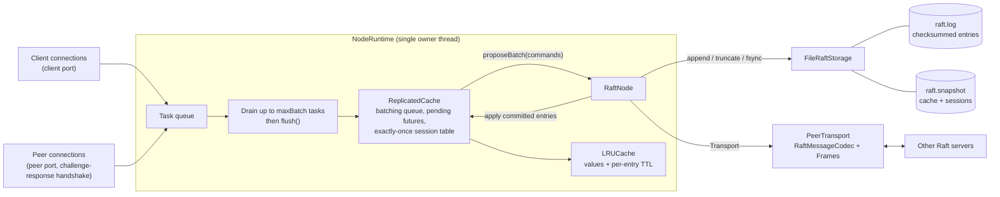
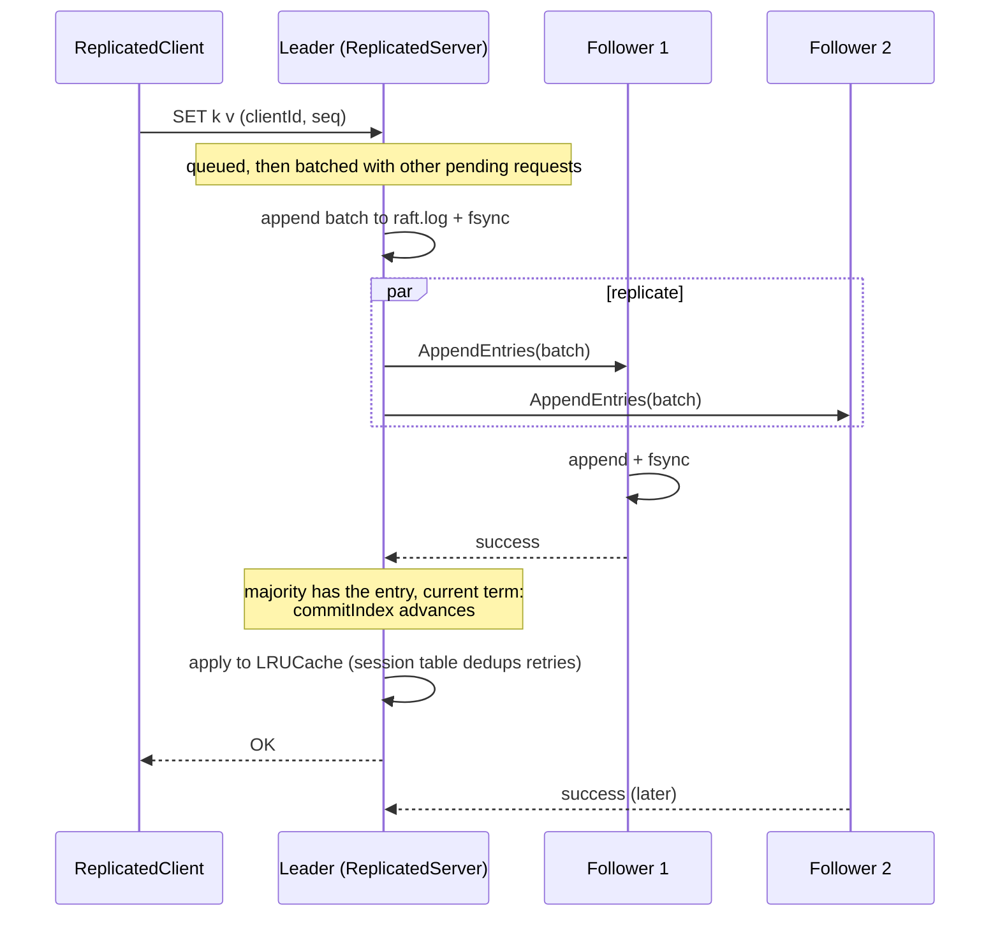
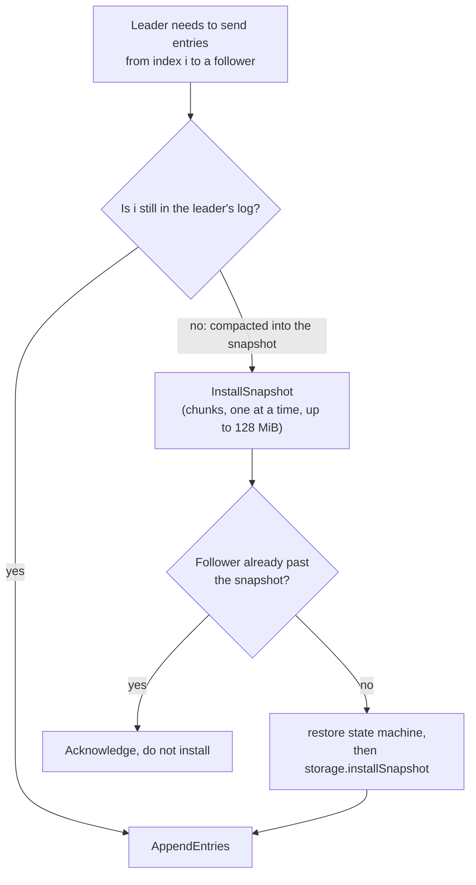
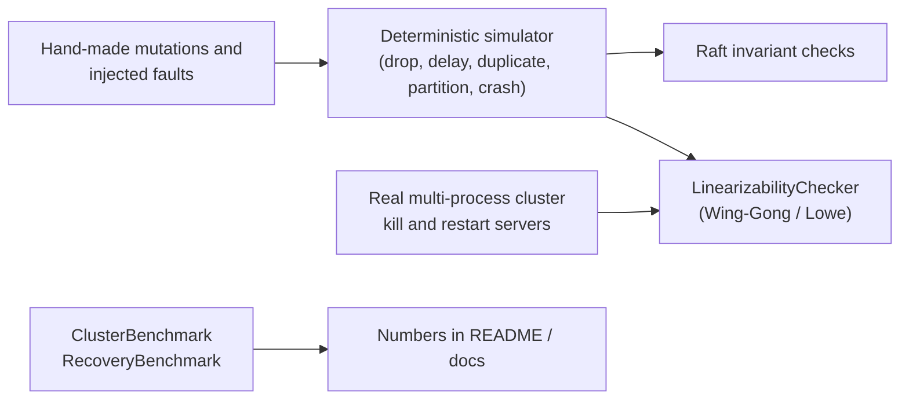

# Architecture

How the pieces fit together. Diagrams are [Mermaid](https://mermaid.js.org/), which GitHub renders directly. Class
names are the real ones in `src/main/java/com/distri/cache/`. Details and invariants live in the linked docs.

## 1. The whole system

DistriCache has two server modes that share the same cache core. They are separate runtimes, not one cluster.

Related: [REPLICATION.md](REPLICATION.md) (mode 1), [RAFT.md](RAFT.md) (mode 2), [PERSISTENCE.md](PERSISTENCE.md),
[METRICS.md](METRICS.md), [SECURITY.md](SECURITY.md).

## 2. Inside one Raft server

One owner thread (`raft-loop-<id>`) runs the `RaftNode`; network threads only hand it work through a queue. That is what
keeps Raft's state single-threaded.

- **Group commit** ([GROUP_COMMIT.md](GROUP_COMMIT.md)): one log append and one fsync per batch of already-queued
  requests. There is no artificial delay; load builds the next batch while the previous one is being fsynced.
- **Replies are sent only after the entry is committed and applied**, and the log is durable before any message that
  depends on it leaves the server.
- **Snapshots** ([SNAPSHOTS.md](SNAPSHOTS.md)): after applying the entry that crosses `--snapshot-every`, the state
  machine is serialised, `raft.snapshot` is written first, then `raft.log` is rewritten without the covered prefix.

## 3. Life of a write

Reads take the same path (through the log), which is why they are linearizable and cost about as much as writes. A
retry with the same `(clientId, seq)` after a lost reply or a leader change returns the stored reply instead of
executing twice.

## 4. Catching up a lagging follower

## 5. Where the evidence comes from

See the Testing section of the [README](../README.md#testing).
