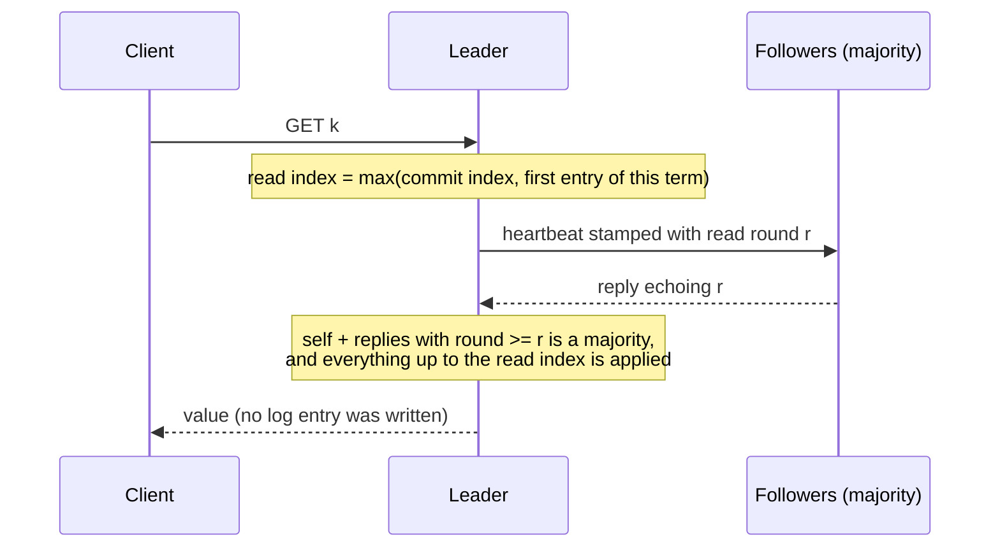

# Read-index reads

By default every GET goes through the Raft log, like a write: appended, fsynced, replicated to a majority, committed,
applied, then answered. That is simple and linearizable, and it makes a read cost as much as a write.

`--read-mode read-index` answers a GET **without writing to the log**, using the read-index method from the Raft
thesis (section 6.4). It is still linearizable. It is **off by default**. With fsync on and few clients the measured
GET gain is large; with fsync off, or with 32 clients, it is within noise (see [Measured](#measuring-it)).

## How a read is answered

When the leader receives a GET it:

1. Notes a **read index**: its commit index, but at least the index of its own first entry of this term (the no-op it
   appends on election). Until that entry is committed the leader cannot be sure its commit index is current, because
   entries committed under earlier leaders may not have reached its commit index yet.
2. Starts a **read round**: it numbers the read (a counter that only grows) and sends a heartbeat to every follower
   stamped with that number. A follower echoes the number in its reply.
3. Waits until replies carrying a round **at or above this read's** have arrived from enough followers to make a
   majority together with the leader. Such replies were sent after the read arrived, so a majority still treated this
   server as leader at that moment. No newer leader can have been elected and committed anything the read would miss.
4. Waits until the state machine has applied everything up to the read index, then answers from its own copy.

No clocks or leases are involved, so clock drift cannot make it wrong. A leader that is cut off from the majority
never gets step 3, so it never answers (it does not guess).



## What had to be true for this to be safe

- **Reads do not reorder the cache.** A normal `LRUCache.get` moves the key to "most recently used". On a log read all
  servers do that in the same order. A read-index read happens on the leader only, so using `get` would make the leader's
  recency order differ from its followers', and later they would evict different keys. Read-index reads use
  `LRUCache.peek`, which changes nothing (it also does not remove an expired entry, which would free capacity on one
  server only). Test: `ReadIndexCacheTest.aReadDoesNotChangeWhichKeyIsEvicted`, `LRUCachePeekTest`.
- **Only replies sent after the read count.** Replies carry the round number of the heartbeat they answer, so a late
  reply to an older heartbeat cannot confirm a newer read. Test:
  `ReadIndexNodeTest.anAcknowledgementOfAnEarlierHeartbeatDoesNotCountForALaterRead`.
- **A leader that loses leadership fails its pending reads** instead of answering them later. The client retries
  elsewhere.
- **Wire format changed.** `AppendEntries` and its reply each carry one more 8-byte field (the round). Servers of this
  version cannot talk to servers of an older one; there is no rolling upgrade across this change.

## How it was tested

| Check | What it shows |
|---|---|
| `ReadIndexNodeTest` (12) | A follower refuses; no answer before a majority acknowledges a heartbeat sent after the read; an old acknowledgement does not count; waits for the term's first entry; no log write; pending reads fail on step-down; one-server group; followers echo the round |
| `ReadIndexScenarioTest` (4) | The situation read-index exists for: a leader is cut off, the others elect a new leader that commits a newer value. The cut-off leader must not answer. After the partition heals it refuses with NOT_LEADER. The new leader returns the new value |
| `ReadIndexCacheTest` (6) | Reads see acknowledged writes; reads add no log entry; reads do not change which key is evicted; demoted leader fails reads; abandoned reads fail |
| `LinearizabilityChaosTest` (+2) | 120 randomized runs with crashes, partitions, loss, duplication, with and without group commit: every recorded history is linearizable |
| `ReadIndexClusterTest` (2) | Real servers and sockets: read-your-writes; 200 reads add 0 log entries; killing the leader under load loses no acknowledged write |
| `WireTest` (+1) | The round survives the wire both ways; a negative one is rejected |

### Injected bugs and hand-made mutations

Three bugs can be switched on in the Raft config for testing (`RaftConfig.Fault`):

| Injected bug | Caught by |
|---|---|
| `READ_SKIP_LEADERSHIP_CHECK` (answer without asking a majority) | `ReadIndexScenarioTest`: the cut-off leader returns the old value. Rare in random runs (about 2 of 150 in my measurement), which is why the scenario test exists |
| `READ_COUNT_OLD_ACKS` (an old acknowledgement counts) | `ReadIndexScenarioTest`, same reason |
| `READ_IGNORE_TERM_START` (do not wait for the term's first entry) | `LinearizabilityChaosTest`: stale reads found in about 45% of random runs (65 of 150 in my measurement) |

Fourteen hand-made breakages of the read-index code were each applied on their own and the read-index tests run;
**all 14 were caught**:

| # | Breakage | First test to notice |
|---|---|---|
| 1 | the read round never advances | `ReadIndexNodeTest` |
| 2 | do not wait for the state machine to catch up | `ReadIndexNodeTest`, `LinearizabilityChaosTest` |
| 3 | the leader counts itself twice | `ReadIndexNodeTest` |
| 4 | require a round strictly greater than the read's | `ReadIndexNodeTest` |
| 5 | a follower's success reply drops the round | `ReadIndexNodeTest`, `ReadIndexScenarioTest` |
| 6 | do not fail pending reads on step-down | `ReadIndexNodeTest` |
| 7 | answer with `get` (reorders the cache) instead of `peek` | `ReadIndexCacheTest` |
| 8 | do not re-check pending reads when a reply arrives | `ReadIndexNodeTest` |
| 9 | read index = commit index only | `ReadIndexNodeTest`, `LinearizabilityChaosTest` |
| 10 | the term's first entry is never recorded | `ReadIndexNodeTest`, `LinearizabilityChaosTest` |
| 11 | no heartbeat is sent when a read starts | `ReadIndexNodeTest` |
| 12 | the wire codec drops the round | `WireTest`, `ReadIndexClusterTest` |
| 13 | a follower accepts reads | `ReadIndexNodeTest`, `ReadIndexCacheTest`, `LinearizabilityChaosTest` |
| 14 | any reply counts as confirmation, whatever its round | `ReadIndexNodeTest`, `ReadIndexScenarioTest` |

One thing I did not test: a late reply with a LOWER round overwriting a higher one (the code keeps the maximum). That
could only delay a read, never make it wrong, and no test distinguishes it.

## Measuring it

Same cluster benchmark as before, now with a read mode:

```
mvn -q package -DskipTests
java -cp target/classes com.distri.cache.node.ClusterBenchmark --read-mode log
java -cp target/classes com.distri.cache.node.ClusterBenchmark --read-mode read-index
```

### Measured (one run per mode, one machine: Windows 10, 2 CPUs, Java 23.0.1, 3 servers and the clients all on it)

GET rows, ops/second (p50 ms in brackets):

| fsync | clients | `--read-mode log` | `--read-mode read-index` | ratio |
|---|---:|---:|---:|---:|
| on | 1 | 258 (3.73) | 3,135 (0.30) | 12.2x |
| on | 8 | 831 (7.57) | 5,662 (1.65) | 6.8x |
| on | 32 | 3,738 (7.15) | 5,237 (6.95) | 1.4x |
| off | 1 | 2,411 (0.36) | 2,865 (0.31) | 1.2x |
| off | 8 | 5,989 (0.96) | 5,566 (1.63) | 0.93x |
| off | 32 | 4,121 (3.04) | 4,779 (7.10) | 1.2x |

**How much of that to believe.** Each cell was measured once, on a machine that runs the servers and the load
generator together, and SET is not affected by the read mode, so the two runs' SET rows show the noise directly:

| SET (control) | `log` run | `read-index` run |
|---|---:|---:|
| fsync on, 1 client | 219 | 258 |
| fsync on, 8 clients | 892 | 790 |
| fsync on, 32 clients | 1,099 | 3,372 |
| fsync off, 1 client | 24 | 797 |

Same operation, same code, up to 3x apart at 32 clients with fsync on, and 33x apart for one client with fsync off
(that cell's max latency was 4.9 s: a stall, not a rate). A GET difference smaller than that cannot be trusted. So:

- **Supported:** with fsync on and 1 or 8 clients, GET is much faster with read-index (12.2x and 6.8x; the SET control
  moved 18% and 11% at those client counts), and p50 falls from 3.7 and 7.6 ms to 0.30 and 1.65 ms. That is the
  expected reason: a log read pays an append and an fsync, a read-index read does not.
- **Not supported:** any gain with fsync off or at 32 clients. 1.4x, 1.2x and 1.2x are inside the noise above, and 0.93x
  at 8 clients with fsync off points the other way. With 32 clients, log reads are already batched by group commit,
  which narrows the gap.
- **Unexplained:** one read-index cell (fsync on, GET, 32 clients) has a max latency of 7,305 ms against a p99 of 14 ms.
  One stall in one run; not investigated.
- Not run: a mixed read/write workload, more than 32 clients, a real network, or repeated runs with a spread.

## Limits

- A read costs one heartbeat round trip to a majority. It is cheaper than a log read (no append, no fsync), but not free,
  and every read triggers its own heartbeat round; this version does not batch several reads into one round.
- Only the leader answers. Reading from followers (which would need the leader's read index first) is not implemented.
- Off by default; the default stays the log read until you decide from your own measurement.
